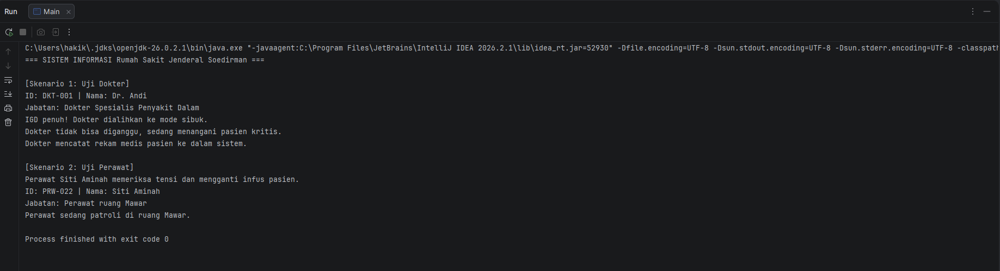

Responsi Akhir PBO - Tema Rumah Sakit

Nama // NIM : Mochammad Syifa Hakiki // H1D025107

Petunjuk untuk  Compile dan Run dengan terminal :

1). Buka terminal atau command prompt.

2). Arahkan (gunakan perintah cd) ke dalam folder tempat file-file Java ini disimpan.

3). Lakukan kompilasi seluruh file Java dengan menjalankan perintah berikut:

javac Main.java tenagaKesehatan.java Dokter.java Perawat.java tindakanMedis.java Administrasi.java

------------------------------------------------------------------------------------------------------------------------------------------

Setelah proses kompilasi selesai tanpa error (muncul file berakhiran .class), jalankan program utama dengan perintah:

java Main

Screenshot Luaran Program

